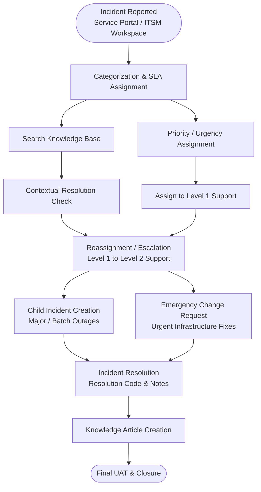

# Incident-Lifecycle-Automation

# Incident Lifecycle Automation in ServiceNow

> An end-to-end ServiceNow ITSM implementation that automates the complete incident management lifecycle, from logging and classification through escalation, emergency change, resolution, and post-incident knowledge creation.

---

## Table of Contents

1. [Project Overview](#1-project-overview)
2. [System Architecture & Incident Lifecycle Workflow](#2-system-architecture--incident-lifecycle-workflow)
3. [Key Project Phases & Core Capabilities](#3-key-project-phases--core-capabilities)
4. [Technology Stack](#4-technology-stack)
5. [Testing & Execution Verification](#5-testing--execution-verification)

---

## 1. Project Overview

In many organizations, IT incidents are reported through emails, telephone calls, or informal communication channels. This results in poor tracking, inadequate classification, delayed escalations, SLA breaches, and minimal visibility into resolution progress. Without structured Incident Management, issues remain unresolved, root causes are overlooked, and business operations suffer avoidable downtime.

This project implements a structured, end-to-end automated Incident Management workflow in ServiceNow. It streamlines incident reporting, enforces SLAs, automates routing across support tiers, and integrates Knowledge Management to enable faster resolution.

---

## 2. System Architecture & Incident Lifecycle Workflow

---

## 3. Key Project Phases & Core Capabilities

### 3.1 Requirement Analysis & Planning

- Defined business objectives, functional requirements, and stakeholder roles, including Requesters, Level 1 and Level 2 Support Engineers, Incident Managers, and System Administrators.
- Mapped the end-to-end incident lifecycle states and resolution metrics.

### 3.2 Service & Service Offering Configuration

- Defined core IT Services and Service Offerings within ServiceNow to anchor incident impact and reporting.
- Configured service dependencies to track incident scope across infrastructure components.

### 3.3 Incident Record Creation & Classification

- Enabled incident logging through the **Service Portal** (`/sp`) and the back-office ITSM workspace.
- Implemented mandatory fields for Incident Category, Subcategory, Impact, Urgency, and Business Service.

### 3.4 Knowledge Integration & Contextual Search

- Integrated ServiceNow **Knowledge Management** to automatically display relevant Knowledge Base articles during incident entry.
- Enabled self-service resolution opportunities for end users prior to ticket submission.

### 3.5 Reassignment, Escalation & Level 2 Tracking

- Built automated assignment rules to route tickets to **Level 1** and **Level 2 Support** based on category and priority.
- Implemented automated escalation triggers to prevent SLA breaches when tickets stall.

### 3.6 Emergency Change & Child Incident Management

- **Child Incidents:** Standardized parent-child relationships to link duplicate incidents to a primary incident during major outages.
- **Emergency Change Request (CHG):** Configured automated creation of Emergency Change Requests directly from major incidents requiring urgent system modifications.

### 3.7 Resolution, Knowledge Base Creation & Final Validation

- Standardized mandatory resolution codes and notes upon ticket closure.
- **Knowledge Article Generation:** Automated the creation of draft Knowledge Base articles from resolved incident work notes, building a repository of known fixes.
- Performed end-to-end User Acceptance Testing (UAT) and functional verification across all workflow stages.

---

## 4. Technology Stack

- **Platform:** ServiceNow ITSM
- **Core Modules:** Incident Management, Service Catalog, Service Portal, Change Management, Knowledge Management
- **Automation & Logic:** Flow Designer, Business Rules, Assignment Rules, SLA Definitions
- **Security & Access:** Role-Based Access Control (RBAC), UI Policies, Data Policies

---

## 5. Testing & Execution Verification

1. **Incident Logging & Classification:** Field validations, SLA timer triggers, and automatic assignment to Level 1 groups were verified.
2. **Escalation & Reassignment:** Transfer from Level 1 to Level 2 assignment groups was confirmed, with updated SLA tracking.
3. **Emergency Change Generation:** Emergency Change Request creation was successfully triggered from high-priority incidents.
4. **Parent-Child Linked Incidents:** State synchronization and automatic closure of child incidents upon parent resolution were verified.
5. **Knowledge Generation & Closure:** New Knowledge Article generation upon resolution and the mandatory resolution fields were validated.

If you meant the Word document, tell me and I'll replace its stage table with a drawn flowchart.
